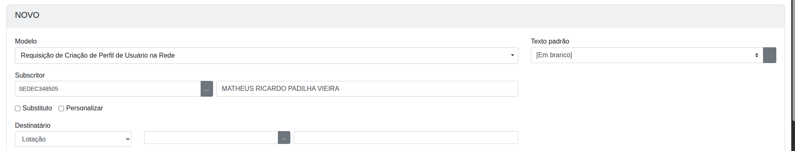

Use este passo a passo para preencher a **Requisição de Criação de Perfil de Usuário na Rede**, tanto para você quanto para outro servidor que precise de acesso.

## Passo 1: Cabeçalho e destinatário

1. **Modelo:** já vem selecionado como "Requisição de Criação de Perfil de Usuário na Rede".
2. **Destinatário:** no campo **Lotação**, selecione a unidade para onde o pedido será enviado.
   - *Geralmente*, seleciona-se a **Coordenadoria de Tecnologia da Informação (TI)**.
