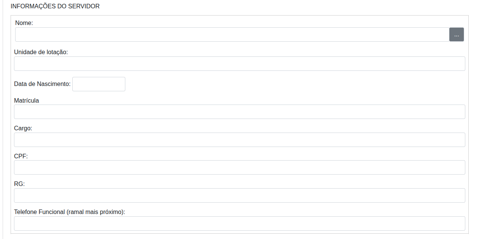

## Passo 2: Informações do servidor

Preencha com os dados de quem receberá o acesso (você ou o servidor para quem está solicitando):

- **Nome / Unidade de Lotação:** use o botão de pesquisa **(...)** ao lado do campo para buscar o servidor no sistema. Isso costuma preencher os outros campos (Matrícula, Cargo etc.) automaticamente.
- **Campos manuais:** se o sistema não preencher tudo, digite manualmente: Data de Nascimento, Matrícula, Cargo, CPF, RG e Telefone Funcional (ramal mais próximo).
