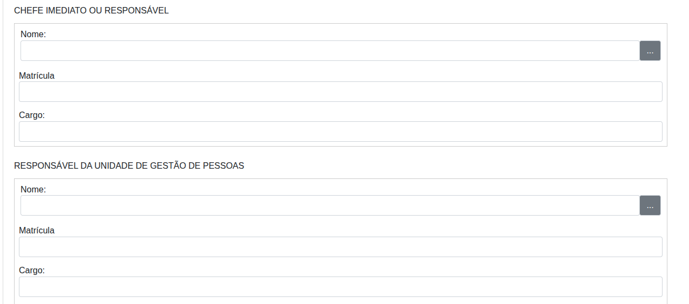

## Passo 3: Autoridades responsáveis

Aqui você identifica quem autoriza o pedido. Use o botão **(...)** para buscar os nomes corretos no sistema:

1. **Chefe Imediato ou Responsável:**
   - Busque e insira o nome do seu supervisor direto (a pessoa a quem você se reporta diretamente).
2. **Responsável da Unidade de Gestão de Pessoas:**
   - Busque e insira o nome do chefe do setor de RH/Gestão de Pessoas.
