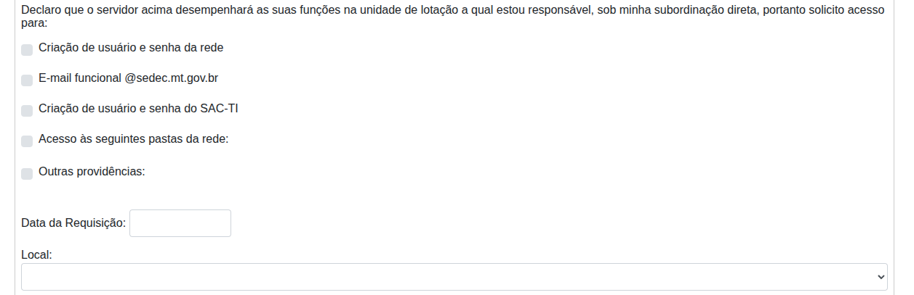

## Passo 4: Solicitações e permissões

1. **Declaração:** o texto já declara que o servidor está sob subordinação da chefia.
2. **Caixas de seleção:** marque exatamente o que o servidor precisa. O padrão básico costuma ser:
   - Criação de usuário e senha da rede.
   - E-mail funcional.
   - Criação de usuário e senha do SAC-TI (se necessário abrir chamados).
   - Se precisar acessar pastas específicas (ex.: Pasta Financeiro, Pasta Jurídico), marque **Acesso às seguintes pastas** e descreva quais são.
3. **Data e Local:** preencha a data de hoje e o local (ex.: Cuiabá).
