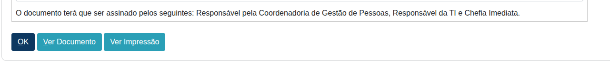

## Passo 5: Como incluir os cossignatários

O formulário tem um aviso no rodapé: ***"O documento terá que ser assinado pelos seguintes: Responsável pela Coordenadoria de Gestão de Pessoas, Responsável da TI e Chefia Imediata."***

**Como o sistema funciona normalmente:**

1. **Ao preencher o formulário:** o preenchimento dos campos "Nome" nas seções de chefia (Passo 3) serve apenas para **identificar** quem são as pessoas no texto do documento.
2. **Após clicar em "OK" ou "Salvar":** o documento será gerado. É **neste momento** que você deve gerenciar as assinaturas.

### Procedimento para as assinaturas

- **Sua assinatura:** assine o documento primeiro.
- **Chefia imediata:** se o seu chefe tem acesso ao processo, solicite que ele assine.
- **Gestão de Pessoas (RH):** o fluxo comum é enviar o processo para a unidade "Gestão de Pessoas". Ao receberem o processo, o responsável de lá verificará os dados, assinará e tramitará para a TI.
- **Responsável da TI:** a assinatura da TI é a última. Ela ocorre quando o processo chega na TI para a execução técnica.
